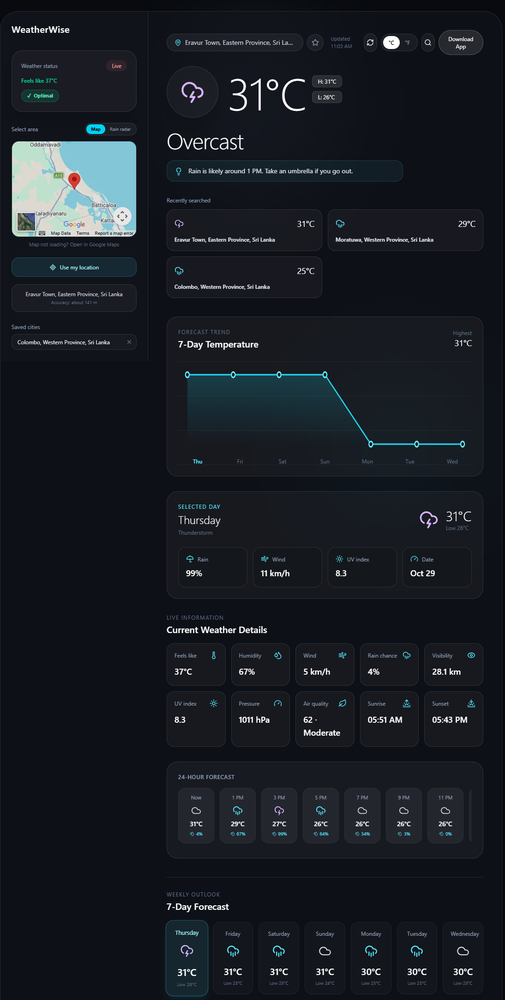

# WeatherWise

A real-time weather dashboard for any city in the world. It shows current conditions, a 24-hour and 7-day forecast, air quality, a rain radar, and works as an installable app that still opens when you are offline.

   **Live demo:** https://weatherwise-sigma-inky.vercel.app

   

   ## Features

- **Search any city** with autocomplete, or use **My Location** (GPS on phones; approximate on desktops, with a warning)
- **Current weather:** temperature, feels like, humidity, wind, pressure, visibility, UV index, sunrise and sunset
- **24-hour forecast** with temperature, weather icon and rain chance
- **7-day forecast** with an interactive temperature chart and a selectable day view
- **Air quality (US AQI)** and a one-line daily tip (umbrella, sunscreen, heat and so on)
- **Rain radar** and map in the sidebar
- **Saved cities** (star button) and recent searches
- **°C / °F** switch that applies everywhere
- **Remembers** your last city, unit and saved cities
- **Auto-refresh** every 15 minutes, plus a manual refresh button and "Updated" time
- **Installable app (PWA)** for desktop and mobile
- **Offline support:** the app opens offline and shows the last forecast with an Offline badge
- **Background glow** that changes with the weather and time of day
- **Loading skeletons**, clear error messages, and automatic retries on failed requests
- **Accessibility:** labelled buttons, keyboard focus styles, and status text that does not rely on colour alone

## Tech stack

- [Next.js](https://nextjs.org/) (App Router) and React with TypeScript
- [Tailwind CSS](https://tailwindcss.com/)
- [lucide-react](https://lucide.dev/) icons
- Service worker and web app manifest for install and offline support
- Deployed on [Vercel](https://vercel.com/)

## Data sources

- Weather, geocoding and air quality: [Open-Meteo](https://open-meteo.com/) (free, no API key)
- Reverse geocoding for "Use My Location": BigDataCloud, with OpenStreetMap Nominatim as a fallback
- Maps and radar: Google Maps embed and [RainViewer](https://www.rainviewer.com/)

## Getting started

Requirements: Node.js 18 or newer.

```bash
# install dependencies
npm install

# start the development server
npm run dev
```

Open http://localhost:3000.

To test the production build (this is also how to try offline mode, because the service worker only runs in production):

```bash
npm run build
npm start
```

## Project structure

```
app/
  layout.tsx        page metadata, share tags, service worker registration
  page.tsx          main dashboard page
  manifest.ts       web app manifest (install support)
components/
  ui.tsx            weather icons, cards, loading skeletons
  RegisterSW.tsx    registers the service worker in production
lib/
  weather.ts        types, API calls with retry, helpers, storage
public/
  sw.js             service worker (offline app shell)
  icon-192.png      app icons
  icon-512.png
```

## Deployment

The project is deployed with the Vercel CLI:

```bash
npm install -g vercel
vercel login
vercel --prod
```

## Known limitations

- Desktop browsers have no GPS, so "Use My Location" may report a nearby big city; the app shows a warning when the location is approximate. Searching for a city always gives exact results.
- Searching for a country name returns a country-level location; searching for a city is more accurate.
- Weather data comes from Open-Meteo's free tier, which has fair-use limits.
- Offline mode shows the most recently loaded forecast; it cannot fetch new data without a connection.

## Credits

Weather data by [Open-Meteo](https://open-meteo.com/). Radar by [RainViewer](https://www.rainviewer.com/).
